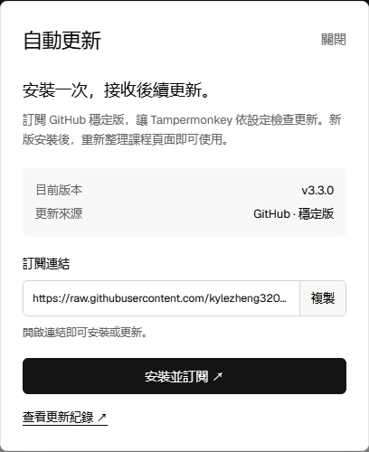

# 課程影片助手

安裝一次，後續自動更新。

用於線上課程頁面的 Tampermonkey 使用者腳本。**3.3.0** 提供固定訂閱入口、版本資訊與 GitHub 穩定版更新，同時保留播放控制與時間統計。

**[安裝並訂閱穩定版 ↗](https://raw.githubusercontent.com/kylezheng320-sudo/course-video-helper/main/subscribe.user.js)**　[查看更新紀錄](CHANGELOG.md)

<picture>
  <source media="(prefers-color-scheme: dark)" srcset="assets/subscription-dark.png">
  
</picture>

## 安裝與訂閱

1. 安裝 Tampermonkey，開啟上方的「安裝並訂閱穩定版」。
2. 在 Tampermonkey 中確認安裝；已有舊版時覆蓋原腳本，避免同時啟用多個版本。
3. 重新整理課程頁面，從助手面板啟動。點擊面板版本號，即可查看更新來源或複製訂閱連結。

訂閱連結固定指向 `subscribe.user.js`，每次發布都與最新版腳本同步。原腳本名稱、命名空間與設定儲存鍵保持一致。

## 自動更新

首次從 3.2.3 或更早版本遷移，需要手動安裝目前穩定版一次。安裝 3.2.4 的使用者可沿用原有更新來源升級。

後續由 Tampermonkey 依自身的更新檢查設定取得版本資訊並下載新版，重新整理課程頁面後生效。如需立即檢查，可在 Tampermonkey 管理介面使用「檢查更新」；實際選項名稱依管理器版本而定。

此更新方式無須依賴本機更新服務，也無須登入 GitHub，但需要能夠連線至 `raw.githubusercontent.com`。GitHub 頁面網址不能代替腳本的原始檔案網址。

## 功能

- 自動播放、靜音、連播及下一個任務點設定。
- 影片互動彈窗處理與章節頁面適配。
- 讀取課程目錄中的影片時長，依所選比例估算剩餘觀看時間。
- 依課程儲存本機可觀察到的累計播放時間。
- 支援暫停、主題切換、收合與拖曳面板。

3.3.0 新增版本與訂閱視窗；播放、章節切換、彈窗處理與計時邏輯沿用已發布版本。

## 發布後續版本

需要 Node.js，無須安裝額外依賴。

1. 修改 `video-helper.user.js` 中的功能程式碼，保留目前版本號。
2. 執行 `node tools/release.cjs prepare 3.3.1`，同步產生腳本、訂閱入口、中繼資料、版本封存與校驗值。
3. 執行 `node tools/release.cjs check`，核對版本、語法、更新網址與檔案一致性。
4. 將這次產生的檔案放在同一個 Git 提交中，推送至 `main`。

更新下載檔案時也必須提高版本號。`release.json` 與 `CHECKSUMS.sha256` 供發布者核對；Tampermonkey 透過 `@updateURL` 與 `@downloadURL` 檢查及下載更新。

本地驗證涵蓋訂閱入口與主腳本一致性、版本產生、複製連結成功及失敗狀態，以及淺深色和三種視窗寬度。檢查紀錄見 [3.3.0 驗證](validation/subscription-3.3.0.json)。

## 支持專案

贊助完全自願，用於支持專案開發與維護。不提供額外付費權益，專案繼續保持開源；無論是否贊助，都可以使用公開發布的專案。

單次支持可在愛發電選擇「其他金額」與「1個月」。

[通过爱发电支持项目](https://afdian.com/a/coursevideohelper)

## 來源

部分影片適配程式碼參考 alv 的上游專案 v5.3.54，來源及修改紀錄見 [來源說明](SOURCE-NOTES-3.0.1.md)。內嵌 Geist / Geist Mono 字型的版權與授權條款見 [字型說明](FONT-NOTICES-3.1.0.txt)。
